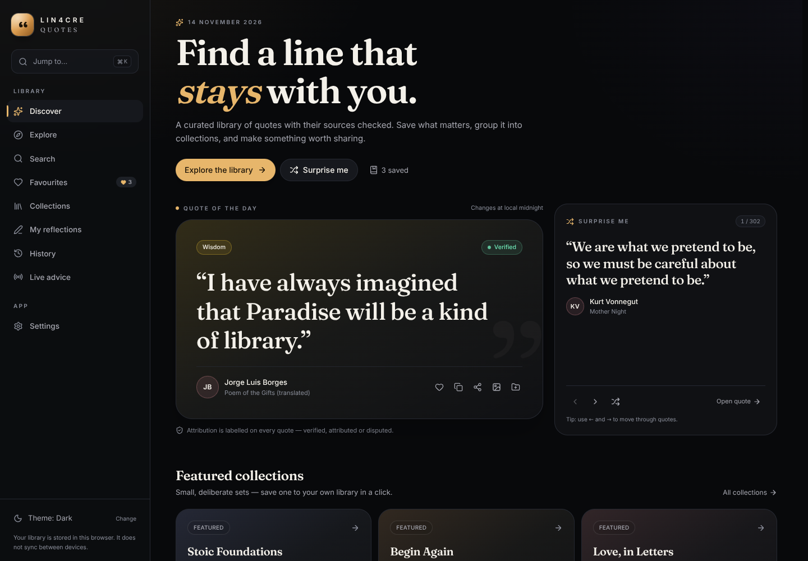
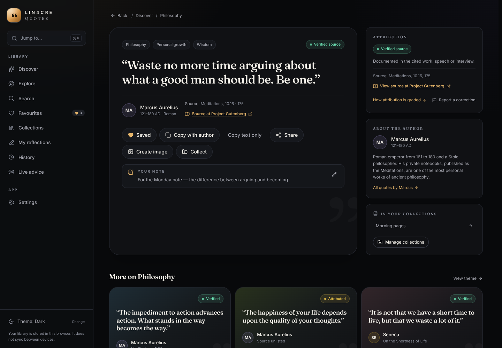
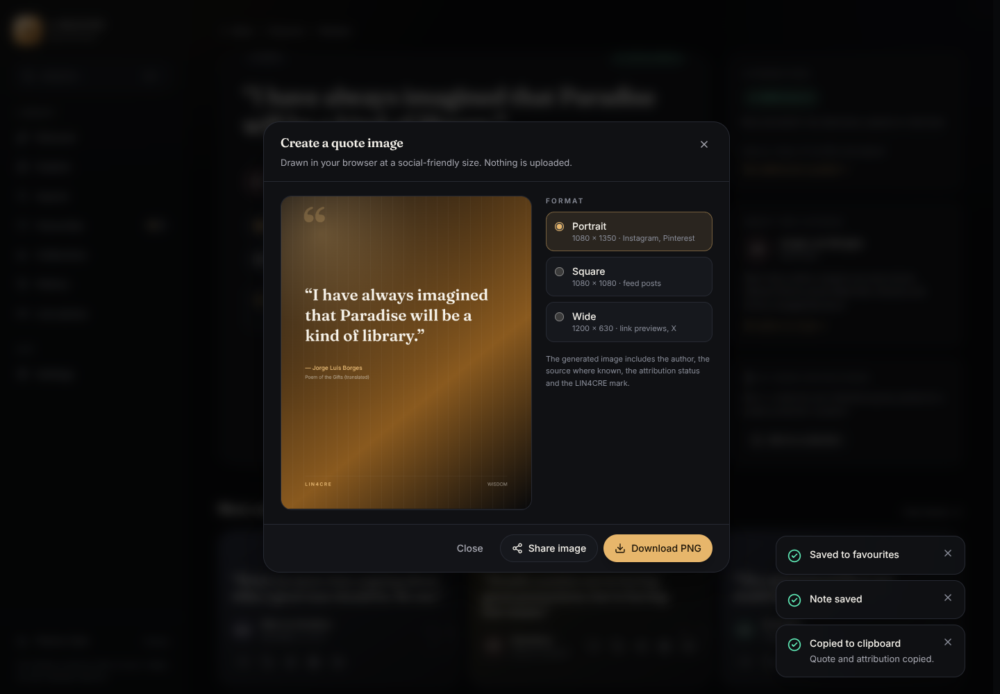
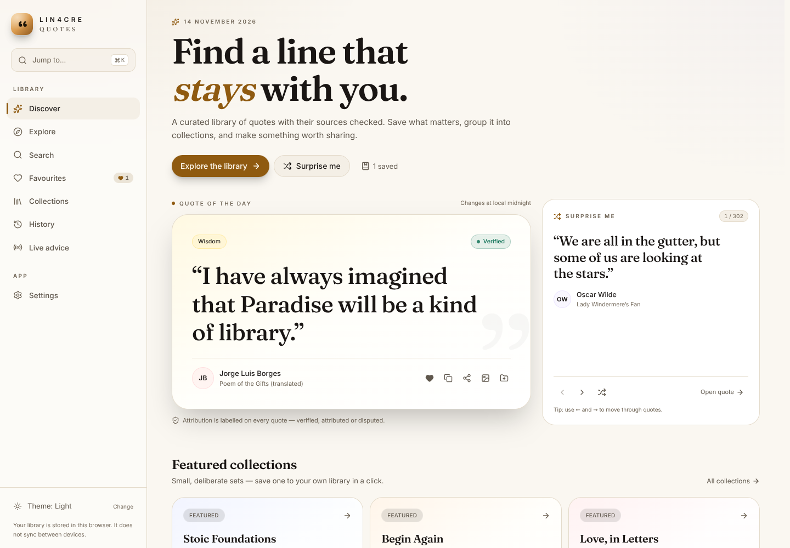
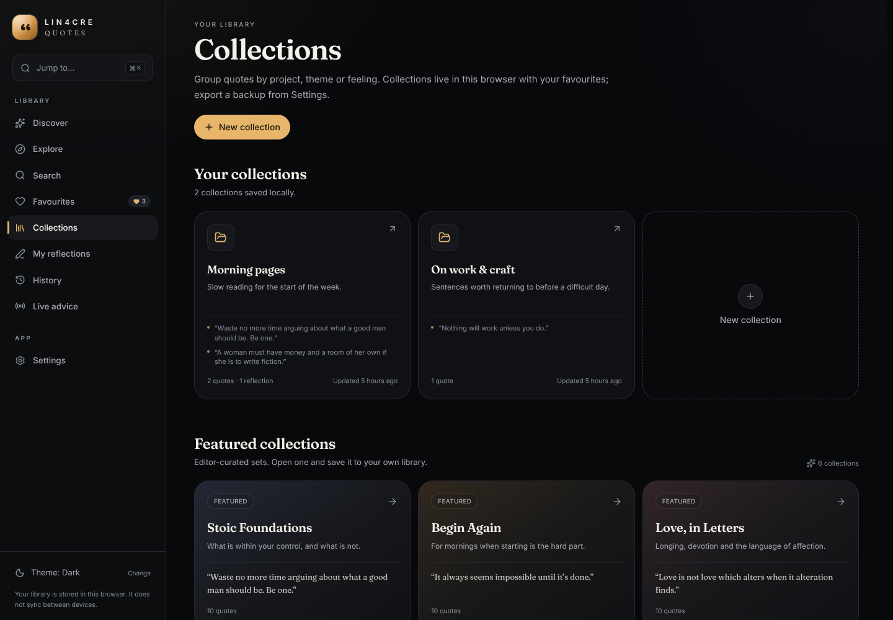
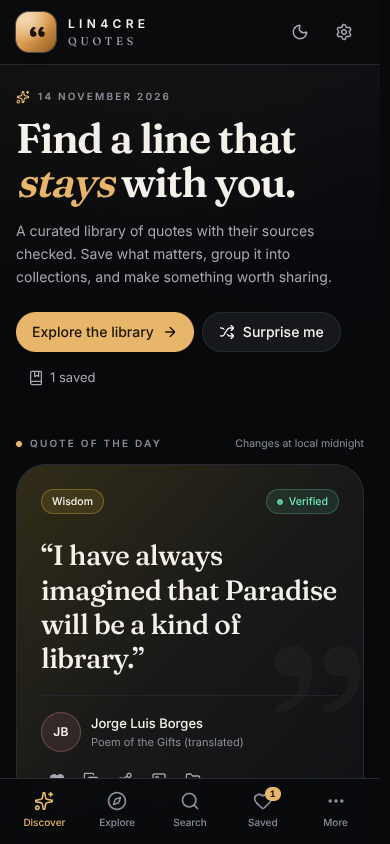
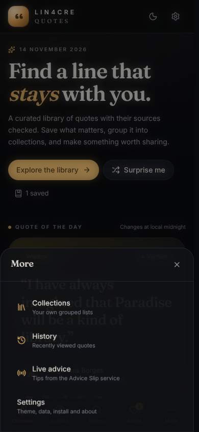

# LIN4CRE QUOTES

**A quote library with its sources attached.** Discover a daily quote, browse fifteen themes and 167 authors, save favourites, write private notes, build collections, and make branded share images — all without an account, a backend or a tracking pixel.

[](https://vite.dev)
[](https://react.dev)
[](https://www.typescriptlang.org)
[](#licence)

**Live:** [lin4cre-quotes.vercel.app](https://lin4cre-quotes.vercel.app) — `main` deploys to production on Vercel; every pull request gets a preview deployment.

---

## Screenshots



| Quote detail                                                                                   | Share-image generator                                                            |
| ---------------------------------------------------------------------------------------------- | -------------------------------------------------------------------------------- |
|  |  |

| Light theme                                                         | Collections                                                                   |
| ------------------------------------------------------------------- | ----------------------------------------------------------------------------- |
|  |  |

<p align="center">
  
  &nbsp;&nbsp;
  
</p>

All screenshots are of the real application, captured in Chromium at 1440×1000 and 390×844.

---

## Features

### Discovery

- **Quote of the day** — deterministic for the local date, so it changes at local midnight without a server.
- **Random quote deck** with refresh, previous/next history and keyboard arrows.
- **Fifteen themes** — Motivation, Success, Life, Love, Happiness, Friendship, Wisdom, Philosophy, Leadership, Business, Confidence, Mental strength, Personal growth, Humour and Inspirational.
- **167 author pages** with short biographies, lifespans and every quote in the library by that author.
- **Featured collections** — six editor-curated sets that can be opened and copied into a personal library.
- **Recently viewed** history (100 entries, deduplicated, grouped by day).
- **Full search** across quote text, author names, themes and sources, with highlighted matches and attribution filters.

### Personal library

- **Favourites** with one-tap add/remove and private notes (up to 2,000 characters).
- **Custom collections** with names, descriptions, inline creation, rename, delete, and add/remove quotes from any card.
- **Reading history** that you can clear without touching saved quotes.
- **Local persistence** in `localStorage`, versioned and validated on load.
- **JSON export/import** and **Markdown export** of favourites.
- **Migration** of entries saved by the original `g.html` page (`growing-page-entries-v1`).
- Clear, honest **empty, error and loading states** throughout.

### Sharing

- Copy the quote text alone, or copy it **with attribution and source**.
- Native **Web Share API** where supported, with a clipboard fallback.
- **Canvas-generated PNG images** in three social formats: portrait (1080×1350), square (1080×1080) and wide (1200×630) — drawn locally, never uploaded.
- Exported cards carry the author, source where known, attribution status and the LIN4CRE mark.

### Platform

- **Dark-first design** with a warm-paper light theme, self-hosted variable fonts and a custom logo/favicon set.
- **PWA**: installable manifest, maskable icons, generated service worker, precached app shell, offline fallback and an in-app update prompt.
- **Offline-safe library**: favourites, notes, collections, history and saved advice remain available without a network.
- **Keyboard shortcuts**: `⌘/Ctrl K` command palette, `/` search, `?` shortcut guide, `r` random quote, `t` cycle theme.
- **Accessibility**: semantic landmarks, skip link, focus-trapped dialogs, labelled controls, visible focus, AA contrast in both themes and reduced-motion support.
- **Security headers** and a strict Content-Security-Policy configured in `vercel.json`; no secrets, no API keys and no environment variables.

---

## Tech stack

| Layer   | Choice                                                                                      |
| ------- | ------------------------------------------------------------------------------------------- |
| UI      | React 19, TypeScript 5.9 (strict, `noUncheckedIndexedAccess`, `exactOptionalPropertyTypes`) |
| Build   | Vite 8, `@vitejs/plugin-react`                                                              |
| Styling | Tailwind CSS 4 with semantic CSS-variable theme tokens                                      |
| Routing | React Router 7, lazy-loaded routes with an error boundary                                   |
| Icons   | Lucide React plus a small inlined GitHub mark                                               |
| Type    | Fraunces Variable (display serif) and Inter Variable (UI sans), self-hosted via Fontsource  |
| PWA     | `vite-plugin-pwa` 2 / Workbox (generateSW), prompt-based updates                            |
| Tests   | Vitest 5, Testing Library, jsdom, axe-core                                                  |
| Hosting | Vercel (static build, SPA rewrite, security headers)                                        |
| CI      | GitHub Actions — lint, type-check, tests, build, artefact verification                      |

No paid services, no backend, no database and no analytics.

---

## Getting started

Requirements: **Node.js 22** (see `.nvmrc`) and npm.

```bash
npm ci
npm run dev        # http://localhost:5173
```

### Scripts

| Command                           | What it does                                                                         |
| --------------------------------- | ------------------------------------------------------------------------------------ |
| `npm run dev`                     | Vite development server with HMR                                                     |
| `npm run build`                   | Type-check with `tsc -b`, then build to `dist/` with the service worker              |
| `npm run preview`                 | Serve the production build locally                                                   |
| `npm run typecheck`               | Strict TypeScript project build                                                      |
| `npm run lint`                    | ESLint (flat config, React Hooks rules)                                              |
| `npm test`                        | Vitest run (64 tests)                                                                |
| `npm run check:build`             | Verifies manifest, icons, service worker, SPA metadata and Vercel headers in `dist/` |
| `npm run format` / `format:check` | Prettier                                                                             |
| `npm run icons`                   | Regenerates PNG icons and the Open Graph card (requires Python 3 + Pillow)           |

### Rebuilding artwork

The generated PNGs are committed, so a normal build never needs Python. To regenerate the icons and Open Graph image after changing the mark:

```bash
python3 -m pip install --user Pillow
npm run icons
```

`public/favicon.svg` and `public/icons/icon-maskable.svg` are the editable vector sources.

---

## Project structure

```
├── public/                 # favicon, PWA icons, OG card, robots.txt
├── docs/screenshots/       # real application screenshots used above
├── scripts/
│   ├── check-build.mjs     # post-build artefact checks (runs in CI)
│   └── generate-icons.py   # Pillow artwork generator
├── src/
│   ├── components/
│   │   ├── discover/       # theme cards
│   │   ├── layout/         # shell, sidebar, mobile nav, banners, shortcuts
│   │   ├── library/        # collection cards/dialog, picker, note editor
│   │   ├── quotes/         # quote card, list, actions, avatar
│   │   ├── search/         # command palette
│   │   ├── share/          # canvas image dialog
│   │   └── ui/             # buttons, modal, badges, fields, skeletons, logo
│   ├── data/               # quotes, authors, categories, curated collections
│   ├── hooks/              # online status, media query, install prompt, title
│   ├── lib/                # search, storage, library model, dates, sharing, image
│   ├── pages/              # one module per route (lazy-loaded)
│   ├── providers/          # settings, library, toasts
│   ├── services/           # Advice Slip client with validation
│   ├── test/               # setup, PWA mock, render helpers
│   ├── types/              # shared domain types
│   ├── App.tsx             # route table
│   ├── index.css           # theme tokens, primitives, animations
│   └── main.tsx            # entry point and provider composition
├── vercel.json             # build/output, SPA rewrite, headers, caching
└── vite.config.ts          # Tailwind, PWA manifest/workbox, Vitest config
```

---

## Content and attribution

The quote library is **curated offline content** shipped with the app, not fetched from a quotation API. Every quote has an explicit attribution status:

| Status                   | Meaning                                                     | Handling                                                    |
| ------------------------ | ----------------------------------------------------------- | ----------------------------------------------------------- |
| **Verified source**      | Documented in the cited work, speech or interview           | Source and year shown                                       |
| **Widely attributed**    | Circulated with the author but no definitive primary source | Labelled as attributed, including in copied text and images |
| **Disputed attribution** | Contested or known misattribution                           | Kept and labelled; an explanation is shown                  |
| **Proverb**              | Traditional saying with no identifiable author              | Attributed to “Proverb”, never to a named person            |

The status is not decorative: it changes the wording of copied quotes and the label drawn onto exported images. Quotes are **never invented**, and no uncertain line is silently presented as verified. Corrections are welcome via issues or pull requests.

### Live advice (the `g.html` integration)

The original page fetched a tip from the free [Advice Slip API](https://api.adviceslip.com/). That functionality is preserved on **Live advice** with substantial hardening:

- Fetch-on-request from `https://api.adviceslip.com/advice?time=…` with `cache: 'no-store'`.
- 10-second timeout via `AbortController`, online/offline detection and visible connection status.
- HTTP, rate-limit (429), malformed-JSON, network and timeout errors mapped to honest messages.
- Payload validated (`slip.advice`, 1–500 characters) before use.
- Saved entries are deduplicated by normalised text, timestamped, capped and restorable after refresh.
- Legacy `growing-page-entries-v1` entries are migrated once, with duplicates removed.
- Advice is kept separate from quotations: it is anonymous, not attributed, and never enters author pages or quote images.
- The service worker treats Advice Slip as **NetworkOnly**, so stale advice is never presented as fresh.

The quote library never depends on this API.

---

## Persistence, export and sync

| Key                          | Contents                                                    |
| ---------------------------- | ----------------------------------------------------------- |
| `lin4cre.quotes.library.v2`  | favourites, notes, collections, history, saved advice       |
| `lin4cre.quotes.settings.v1` | theme, text size, motion and disputed-quote preferences     |
| `growing-page-entries-v1`    | legacy advice entries read once and removed after migration |

Data is read defensively: malformed records are skipped, unknown quote ids are discarded, collections are capped at 100 and names at 80 characters. If `localStorage` is unavailable or full, a visible banner warns that changes will not survive a refresh.

Exports are pretty-printed JSON with an `app` signature, schema version, timestamp and optional settings. Imports merge rather than overwrite: local notes win, matching collection names are combined, and history/advice are deduplicated.

**There is no cross-device sync, and the app never pretends there is.** Use export/import to move a library between browsers.

---

## PWA and offline behaviour

- Manifest: standalone display, start URL `/`, scope `/`, theme/background `#08090b`, 192/512/maskable icons and three app shortcuts.
- Service worker: precaches the HTML shell, hashed JS/CSS, self-hosted fonts, icons and manifest; navigation falls back to `index.html` for deep links.
- Updates use `registerType: 'prompt'`; a banner offers a refresh instead of replacing the app mid-session.
- Advice Slip requests are excluded from caching and require a network.

### Install

- **iPhone/iPad:** Share → **Add to Home Screen**.
- **Android (Chrome):** menu → **Install app** / **Add to Home Screen**.
- **Desktop (Chrome/Edge):** install icon in the address bar, or **Settings → Install the app**.
- Safari on iOS does not fire `beforeinstallprompt`; the Settings page documents the manual route.

---

## Accessibility

- One `h1` per page, labelled landmarks, a skip link and a logical heading order.
- Dialogs trap focus, close on `Escape`, lock background scrolling and restore focus.
- Every icon-only control has an accessible name; stateful controls expose `aria-pressed`/`aria-selected`.
- Live regions announce search result counts, toast messages and connection state.
- Semantic colour tokens provide AA contrast in both themes (verified with axe-core in Chromium).
- Motion respects `prefers-reduced-motion`, a `data-motion` attribute and an in-app switch.

---

## Testing

All of the following were run on the implementation in this repository.

| Check                              | Command                                                 | Result                                                                                                       |
| ---------------------------------- | ------------------------------------------------------- | ------------------------------------------------------------------------------------------------------------ |
| Strict type-check                  | `npm run typecheck`                                     | Passed                                                                                                       |
| Lint                               | `npm run lint`                                          | Passed                                                                                                       |
| Unit/component tests               | `npm test`                                              | **64 passed / 64** across 9 files                                                                            |
| Production build                   | `npm run build`                                         | Passed (86 precache entries)                                                                                 |
| Artefact verification              | `npm run check:build`                                   | **46/46 conditions passed**                                                                                  |
| Browser flows (Chromium)           | ad hoc script against the dev server                    | **13/13 passed** — routing, search, notes, copy, share image, collections, theme, mobile nav, reduced motion |
| PWA/offline (Chromium)             | ad hoc script against `vite preview`                    | **6/6 passed** — SW control, manifest, precache, offline reload, offline navigation, deep link               |
| Accessibility (axe-core, Chromium) | 40 scans across 10 routes × desktop/mobile × dark/light | **0 violations** (WCAG 2.0/2.1 A and AA)                                                                     |

Test coverage includes:

- data integrity (unique quotes, real authors/themes, attribution rules, all 15 themes, curated collections);
- search ranking, filters, accents/punctuation and highlight segmentation;
- library state: favourites, notes, collections, duplicates, history, advice deduplication, migration, merge, clear, rehydration;
- Advice Slip validation, HTTP/rate-limit/offline/malformed/network handling;
- quote text with attribution/disputed/proverb labels, clipboard success/failure, Web Share and cancellation;
- quote detail: rendering, history recording, save/note, copy, share, disputed notes, 404, collection creation, back navigation;
- search/favourites/collections/settings pages, import/export, invalid JSON, destructive-action confirmation, theme/font/motion settings;
- application startup, routing, 404, keyboard shortcuts and axe checks in jsdom;
- offline hook, offline advice state and the shell offline banner.

Browser-only checks above were executed in this build environment with headless Chromium and are not part of the committed CI suite (CI runs lint, type-check, Vitest, build and artefact checks). No test result is claimed unless it was actually run.

---

## Deployment

`vercel.json` is the complete deployment configuration:

- Framework `vite`, build `npm run build`, output `dist`, install `npm ci`.
- SPA rewrite to `/index.html` for client-side routes.
- CSP allowing only self-hosted assets plus `https://api.adviceslip.com`; `img-src` includes `blob:` for generated images.
- `X-Content-Type-Options`, `X-Frame-Options`, `Referrer-Policy`, `Permissions-Policy`, `Cross-Origin-Opener-Policy`.
- Immutable one-year caching for hashed assets; no-cache for `sw.js` and the manifest; `Service-Worker-Allowed: /`.

The Vercel project is connected to **`LIN4CRE/Quotes`**, with `main` as the production branch and automatic preview deployments for pull requests. No environment variables are required.

To deploy elsewhere: `npm ci && npm run build`, serve `dist/` as static files with an SPA fallback to `index.html`, and keep the headers above if your host supports them.

---

## Known limitations

- The library is finite and maintained by hand (302 quotes at the time of writing); it is not a complete quotation archive.
- Attribution research is careful but not infallible. Disputed entries carry an explanation and corrections are welcome.
- Some quotations are common English translations rather than the original wording.
- Advice Slip is an external free service; it can be slow, rate-limited or unavailable.
- Native sharing, clipboard and install prompts depend on browser support.
- Local data is per browser and per device; clearing site data removes the library unless you exported a backup.
- Generated images use locally available fonts. The app loads Fraunces and Inter, but a browser that blocks font loading will fall back to serif/sans-serif metrics.

---

## Licence

Application code: [MIT](LICENSE). Quotations remain the property of their authors and rights holders and are included for reference and inspiration; translations may carry separate rights. Fonts are licensed under the SIL Open Font License via Fontsource. Icons are from [Lucide](https://lucide.dev) (ISC). Advice content is provided by [Advice Slip](https://api.adviceslip.com/).
